+++
title = "Supporters"
description = "Our supporters"
+++

Un agradecimiento especial a nuestros colaboradores.

 

 

[ISMOS](https://ismos.xyz/) - ISMOS ofrece cursos para aprender a construir sobre el protocolo Bitcoin, con becas disponibles.

[La Crypta](https://lacrypta.ar/) - La Crypta es una organización Argentina dedicada al desarrollo, la educación y la difusión del conocimiento dentro de los ecosistemas de Bitcoin y Nostr.